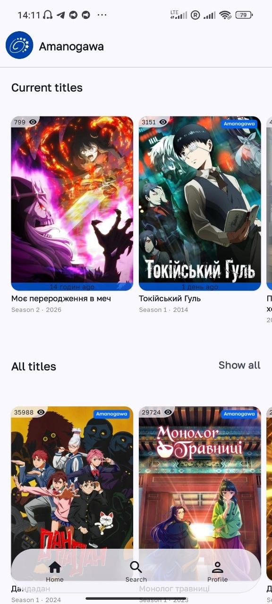
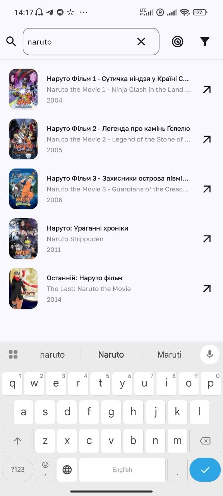
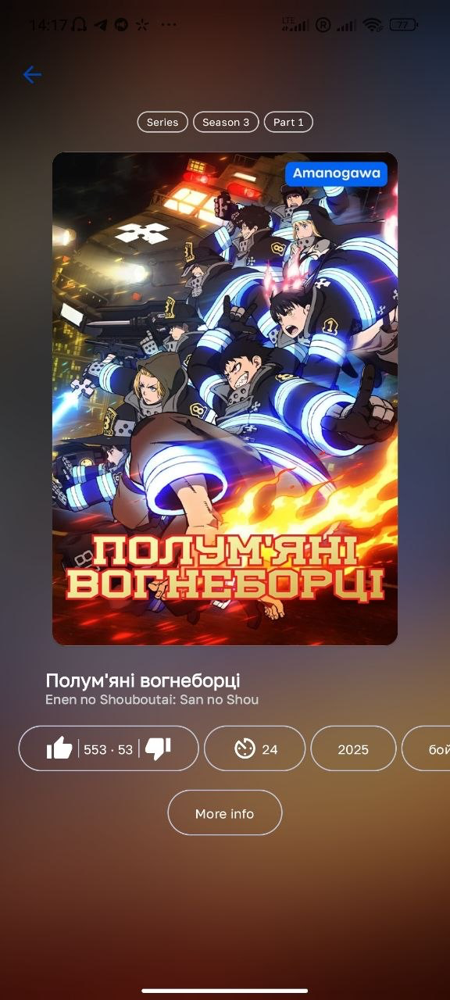
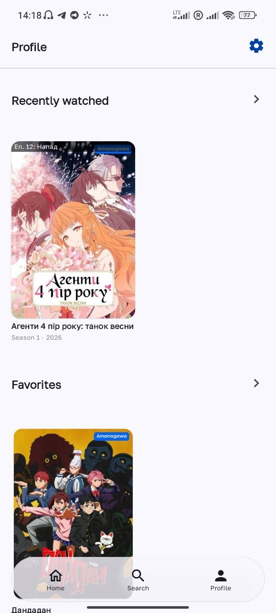

# Amanogawa 🌌

[](https://kotlinlang.org)
[](https://developer.android.com/studio/releases/gradle-plugin)
[](https://developer.android.com/jetpack/compose)
[](https://developer.android.com)
[](https://developer.android.com)
[](#architecture)

**Amanogawa** is a modern, responsive, and open-source Android client designed for browsing, searching and tracking anime titles powered by the Amanogawa API (`https://amanogawa.space/api/`). Built entirely with modern Android development standards, featuring Jetpack Compose, Material 3, Koin, Ktorfit, Room, and a modular architecture.

---

## 📸 Screenshots

| Home & Discover | Anime Details | Search & Filters |
| :---: | :---: | :---: |
|  |  |  |

| Random Carousel | Profile tab |
| :---: | :---: |
|  |  |

---

## ✨ Features

- 🏠 **Home Screen**: Explore ongoing anime seasons, latest updated releases, and spotlight banners.
- 🎬 **Comprehensive Anime Details**: Detailed synopsis, episode listings, team/translator credits, and zoomable artwork previews.
- 🔍 **Advanced Search & Discovery**:
  - Full-text search with instant results.
  - Multi-criteria filtering (genres, formats, release years, seasons, status).
  - Interactive **Random Anime Carousel** to discover unexpected gems.
- ⭐ **Favorites & Watch History**:
  - Bookmark favorite anime series locally with Room Database & Paging 3.
  - Keep track of watched episodes and ongoing viewing progress.
- 🔔 **Episode Release Notifications**:
  - Background periodic checking via **AndroidX WorkManager**.
  - Grouped system notifications for newly aired episodes.
- 🎨 **Material 3 Design & Dynamic Theming**:
  - Full support for Dynamic Color (Material You).
  - Seamless Light and Dark mode switching.
  - Customizable appearance settings via Jetpack DataStore.

---

## 🏗️ Architecture & Project Structure

The project strictly adheres to **Clean Architecture** and a multi-module structure powered by Gradle Convention Plugins:

```
Amanogawa/
├── app/                  # Main entry point, DI bootstrap, Voyager root navigation
├── build-logic/          # Custom Gradle convention plugins (Kotlin, Compose, Koin, etc.)
├── feature/              # Presentation feature modules (Compose UI + ScreenModels)
│   ├── home/             # Home feed and current updates
│   ├── anime/            # Title details, episode playback, image views
│   ├── search/           # Search, advanced filtering, random anime discovery
│   ├── favorite/         # Favorites list & watch history
│   └── profile/          # User settings, appearance, licenses, team info
├── core/                 # Shared foundational layers
│   ├── ui/               # Design system, themes, components, typography
│   ├── model/            # Shared domain entities & data models
│   ├── domain/           # Business logic and UseCases
│   ├── data/             # Repository implementations and data mappers
│   ├── database/         # Room database, DAOs, entities, and migrations
│   ├── network/          # Ktorfit & Ktor HTTP client, API interceptors, serializers
│   ├── datastore/        # DataStore preferences (theme, settings)
│   ├── navigation/       # Voyager screen declarations & shared routing
│   ├── notification/     # Android notification channels and managers
│   ├── work/             # WorkManager workers for background sync
│   └── common/           # Error handling, extensions, and utilities
└── screenshots/          # Showcase assets for documentation
```

---

## 🛠️ Tech Stack & Libraries

- **Language**: [Kotlin](https://kotlinlang.org) (2.4.0) with Coroutines and Flow.
- **UI Framework**: [Jetpack Compose](https://developer.android.com/jetpack/compose) with [Material 3](https://m3.material.io) and Material Adaptive Navigation Suite.
- **Navigation & State**: [Voyager](https://voyager.adriel.cafe) (Navigator, TabNavigator, ScreenModel).
- **Dependency Injection**: [Koin](https://insert-koin.io) (Koin Annotations + Koin BOM).
- **Networking**: [Ktorfit](https://foso.github.io/Ktorfit/) + [Ktor Client](https://ktor.io) with OkHttp engine and [Kotlinx Serialization](https://github.com/Kotlin/kotlinx.serialization).
- **Image Loading**: [Coil 3](https://coil-kt.github.io/coil/) (with GIF and OkHttp integrations).
- **Local Persistence**:
  - [Room](https://developer.android.com/training/data-storage/room) with [Paging 3](https://developer.android.com/topic/libraries/architecture/paging/v3-overview)
  - [Jetpack DataStore](https://developer.android.com/topic/libraries/architecture/datastore) (Preferences)
- **Background Tasks**: [AndroidX WorkManager](https://developer.android.com/topic/libraries/architecture/workmanager)
- **UI Utilities**: [Zoomable](https://github.com/saket/telephoto/tree/main/zoomable) (gesture-driven image zooming), [AboutLibraries](https://github.com/mikepenz/AboutLibraries).

---

## 🚀 Getting Started

### Prerequisites

- **Android Studio**: Android Studio Ladybug (2024.2.1+) or newer.
- **JDK**: JDK 17 or JDK 21 recommended.
- **Android SDK**: Min SDK `31` (Android 12), Target SDK `37`.

### Clone & Build

1. Clone the repository:
   ```bash
   git clone https://github.com/anison-id/Amanogawa.git
   cd Amanogawa
   ```

2. Open the project in **Android Studio** and let Gradle sync.

3. Build debug APK using Gradle:
   ```bash
   ./gradlew assembleDebug
   ```

4. Run unit tests across modules:
   ```bash
   ./gradlew test
   ```

---

## 📄 License

This project is licensed under the terms of the open-source license. Third-party library licenses can be viewed directly within the app in **Profile → Open Source Licenses** powered by AboutLibraries.
